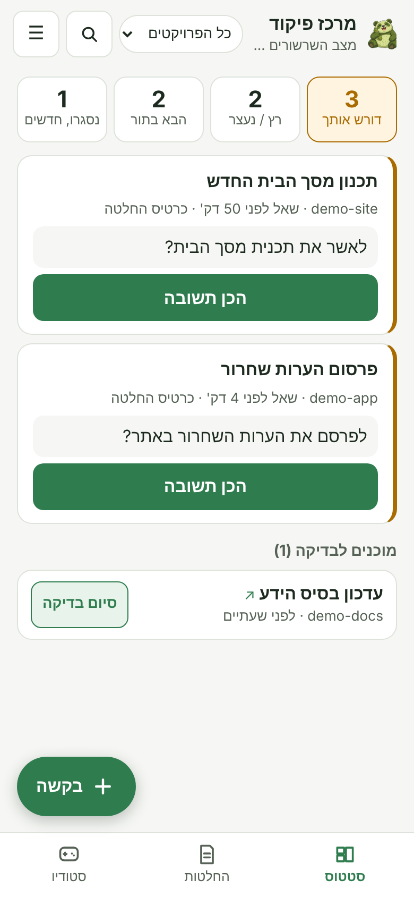
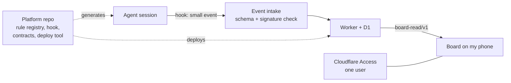
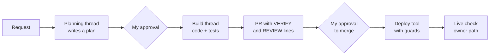

# Agent Control Room

An operating system for a team of AI agents, run from my phone. It has three parts: a board that shows every agent session, every approval waiting on me and what is stuck; a rulebook that is enforced in code instead of trusted as text; and a deploy tool with guards. A personal system in daily use.


<p align="center">
  
</p>

*The board on a phone, with made-up demo data: two decisions waiting on me, one thread ready for review, and counters for what is running and what is next.*

## About

I run several projects with a team of Claude agents that have defined roles: coordinator, planner, builder, DevOps, code reviewer, privacy, UX, copywriter and others. After a few dozen sessions the question stopped being "can the agent do it?" and became "what is running, what is waiting for me, and what quietly went wrong?" A chat window does not answer that. This project does.

**In numbers** (checked against the code): 16 role cards, 38 rules in one registry, 10 of them in a block every session loads, 6 checks in the session hook, 4 deploy guards, and over 370 unit tests on the board.

- **A board** (TypeScript Cloudflare Worker + D1, vanilla JavaScript front end, one allowed user). Unit tests, type checking and a secret scan run before every merge.
- **A rulebook with one source of truth.** 14 role cards, plus manager and planner cards, and a block of 10 rules and 1,353 characters that every session loads. The character budget (1,800) is checked in CI.
- **Enforcement in a session hook.** Six rules are built into the hook: three block the action and three warn.
- **A deploy tool with four guards.** Deploys come from one tool, not from CI, and every deploy must prove the owner can still get in.

## Why

Agents are good at tasks and bad at staying consistent across many of them. Instructions grow, sessions forget, and a rule that lives only in a paragraph is easy to skip. The useful work is the operating layer around the agents: visibility, rules that hold, and a human who approves what cannot be undone.

## Architecture



- Hooks in the agent sessions send small events: a thread started, a thread needs review, an approval is requested.
- The Worker stores events and computes state. Status comes from deterministic events, not from running a model.
- The hooks fail safe: if the board is down, the agents keep working.

### Contracts with a version

Every part talks to the others through a contract with a version, so a part can be replaced without touching the rest.

| Contract | Between | What it fixes |
|---|---|---|
| `board-read/v1` | Worker and board | The fields the board reads, and nothing more |
| `thread.state/v3` | Events and Worker | How a thread's state is decided from events |
| `perf-budget/v1` | Every route | Query count, time and size limits per route |
| `pr-gate/v1` | PR and merge | The `VERIFY` and `REVIEW` lines a PR must carry |

### An event

Events carry a title, a state and short text (at most 280 characters; owner replies are cut to 200). Never secrets.

```json
{
  "v": 1,
  "id": "evt_2026_11_09_0042",
  "ts": "2026-11-09T10:15:00Z",
  "source": "hook",
  "kind": "approval.requested",
  "project": "example-project",
  "thread": { "id": "thread-123", "title": "Prepare release notes" },
  "summary": "Publish the release notes?",
  "data": { "approvalId": "a-17", "text": "Publish the release notes?", "reversible": false }
}
```

## How the agent team works

- **A coordinator talks to me; specialists do the work.** Each role has a card with a definition of done and the skills it must load.
- **Plan and build are separate threads, on different models.** A planning thread writes a plan and hands it over. It cannot push, open a PR or deploy, even after I approve. A separate build thread does that.
- **One thread, one task.** State lives in a file in the repo, not in the conversation. A thread that nears its context limit hands the work to a fresh one.
- **Experts, not assistants.** Every thread must find the root of the problem, state the simplest working solution before an elaborate one, and say up front what it needs from me.
- **Every decision is written down** the moment it is made, in a knowledge base kept in a repo.

### One change, end to end



## Rules as code, not as text

Rules started as one long document for four readers (me, the manager, every thread and an install procedure). As it grew, compliance dropped. The fix was structural:

1. One **rule registry**: each rule once, in Hebrew and English, with where it applies and how it is enforced. The pasted block and the English rulebook are generated from it.
2. **Split by reader**: a short block everyone loads, a role card per role, one procedure per task.
3. CI checks the rule budget and that generated files match the registry.
4. A rule important enough to break something moves from text into the **hook**, where it blocks instead of advising.

A rule in the registry (abridged):

```json
{
  "id": "one-task-plan-hands-off",
  "where": "block",
  "en": "One thread is one task and one stage. A planning thread does not change code, open a PR or deploy, even after an approval; it hands a plan to the manager, who opens a build thread.",
  "enforcement": [
    { "type": "hook", "where": "PreToolUse: push, PR, merge and deploy are denied in a planning thread", "status": "built" },
    { "type": "text", "where": "this rule, thread-opening contract", "status": "live" }
  ]
}
```

And what the hook answers when a planning thread tries to push:

```json
{
  "hookSpecificOutput": {
    "hookEventName": "PreToolUse",
    "permissionDecision": "deny",
    "permissionDecisionReason": "Planning threads hand off, they do not build. Send the plan to the coordinator."
  }
}
```

Six checks are built this way (three block, three warn): one question per report, a report ends with its follow-up lines, a planning thread cannot push, open a PR or deploy, context size warnings, thread title format, and the rules version in the project instructions.

## Human in the loop, by design

Every action falls into one of three tiers:

| Tier | Examples | Who decides |
|---|---|---|
| Reversible | Open a branch or a PR, run tests, deploy to the test environment | The agent, and it reports |
| Needs a check | Merge, change shared settings | An independent reviewer, then me |
| Cannot be undone | Production, store, deletion, money, outbound messages | Only me, for that exact step |

- An approval button never executes anything. It only prepares the approval text for me to send.
- Writes to production are refused in code. Writes to the test environment need an explicit confirmation:

```ts
export function guardWrite(env: "test" | "production", action: string, confirm: string | null) {
  if (env === "production") return { ok: false, reason: "writes are disabled in production" };
  if (confirm !== action) return { ok: false, reason: "explicit confirmation required" };
  return { ok: true };
}
```

- **Deploys go through one tool with four guards:** it refuses a deploy that would blank a live variable or remove a binding; it checks a per-target contract before and after; it rolls back automatically when a post-deploy check fails; and every check must pass against the live version before the deploy, so a check that cannot pass says nothing afterwards.
- **Independent review before merge.** A PR for the server or the dashboard carries a `VERIFY` line (tests, types, secret scan) and a `REVIEW` line from an independent reviewer. A script checks both lines against the PR head, without spending CI minutes.

## Performance budget

Every route a screen loads has a budget, enforced in tests with `Server-Timing`:

- a constant number of queries, independent of how much data exists;
- independent queries run in parallel;
- the route returns only what the screen shows (debug data behind `?debug=1`);
- about 2 seconds and a byte limit per route.

A test fails on any full table scan, and every PR that touches a route records its numbers before and after. Applying the budget to the main board took it from about 9 seconds to 1.4–1.9 seconds, with 12 queries in 3 parallel waves.

## Security

- The dashboard sits behind Cloudflare Access with a single allowed user.
- The event intake accepts POST only, requires a bearer token or an HMAC-signed body, and fails closed when no secret is configured.
- Events are size-limited and de-duplicated by id. Routine events are pruned after 30 days; lasting facts (decisions, release steps) are kept.
- Colors come from one token file, a build check fails on a hard-coded color, and agents read a component index before changing UI, so every screen stays consistent.

## Engineering practices

1. **Fix the cause, then make it visible.** Components never fail silently: the hook reports why it skips an event, and the board shows when a session's hook is out of date.
2. **A rule that matters lives in code.** When a rule is important enough to break something, it moves from the rulebook into the hook, where it blocks instead of advising.
3. **Split instructions by reader.** A short block everyone loads, a card per role, one procedure per task, with a size budget checked in CI.
4. **A check must prove the good path, not only the bad one.** Post-deploy checks verify that the owner gets in, not just that strangers are refused, and every check must pass against the live version before it can guard a deploy.
5. **Measure what the user feels.** Performance work targets page time and query count per route, not only database reads.
6. **Review is provable.** Every server or dashboard PR carries a `VERIFY` and a `REVIEW` line checked against the PR head, and the reviewer runs on a model at least as strong as the builder.
7. **State belongs in a file, not in a conversation.** A fresh thread per task, with the handover written to a file.
8. **Test in a real browser.** Anything a user touches gets an end-to-end check in a real browser, because stubbed browser tests cannot see browser bugs.

## What's next

Per-project event keys, a clean install for a new account, and a template others could use.

## Contact

Zahi Michaeli: [LinkedIn](https://www.linkedin.com/in/zahi-michaeli)
